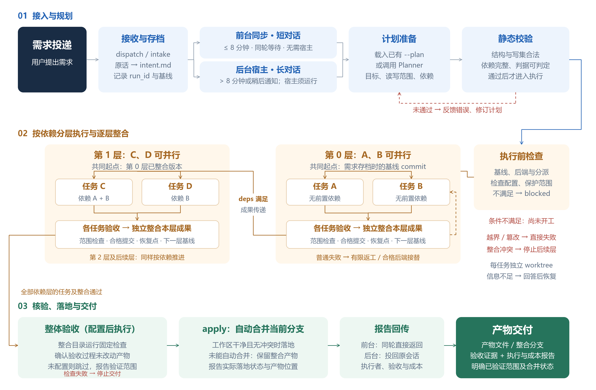

# orch 全流程示意图

- `orch-flow.svg` / `orch-flow.png`：当前横向三行版，4000 × 2620 高清图片，适合文档排版；保留 01 / 02 / 03 分区标题，无全图标题及页尾说明。
- `orch-flow-landscape.svg` / `orch-flow-landscape.png`：同一横版的明确命名副本；第一行从左向右、第二行从右向左、第三行从左向右，蛇形衔接。
- `orch-flow-vertical.svg` / `orch-flow-vertical.png`：保留此前的纵向版本。

依据本仓库 v1.9.7 当前实现绘制，核对日期：2026-11-14。
图中 A / B 为第 0 层并行任务；第 1 层 C 依赖 A、B，D 依赖 B。第 0 层任务验收并整合后，第 1 层才从已整合版本启动。任务与层数均为示例，并非固定配置。

实现依据：

- `orch/intake.py`：原话存档、运行标识与 Git 基线。
- `orch/dispatch.py`：前台同步、宿主队列、计划入口、对照实验、自动合并与报告回传。
- `orch/eta.py`：按预计任务耗时选择前台或后台，自动估时参考阈值为 480 秒（8 分钟）。
- `orch/planner.py`、`orch/contract.py`：任务契约、静态校验与规划反馈。
- `orch/runner.py`：执行准入、后端分派、按层执行、任务验收、独立整合与整体验收。
- `orch/apply.py`：当前分支合并、工作区检查与冲突回滚。
- `orch/control.py`、`orch/recovery.py`：资源限制、取消、人工回答与恢复。

重要口径：当前实现允许在缺少 `verification.json` 时跳过整体验收；报告必须说明验证范围，不能声称已验证整体可用。配置存在但无效时会在执行前阻断。普通失败的自动返工与后端接替受执行策略约束；额外重新规划默认关闭。任务或整体验收失败均不自动合并到用户分支。执行成功与自动合并成功是两个独立结果。

图中的“短对话 / 长对话”指本次任务预计运行耗时和是否同轮等待，不是用户消息字数。自动模式有可用计划时按估时分流；无可用计划时按宿主是否运行分流。显式指定的前台或后台模式优先；后台执行需要常驻宿主。长任务但无宿主时自动模式会退回前台并提示超时风险。
